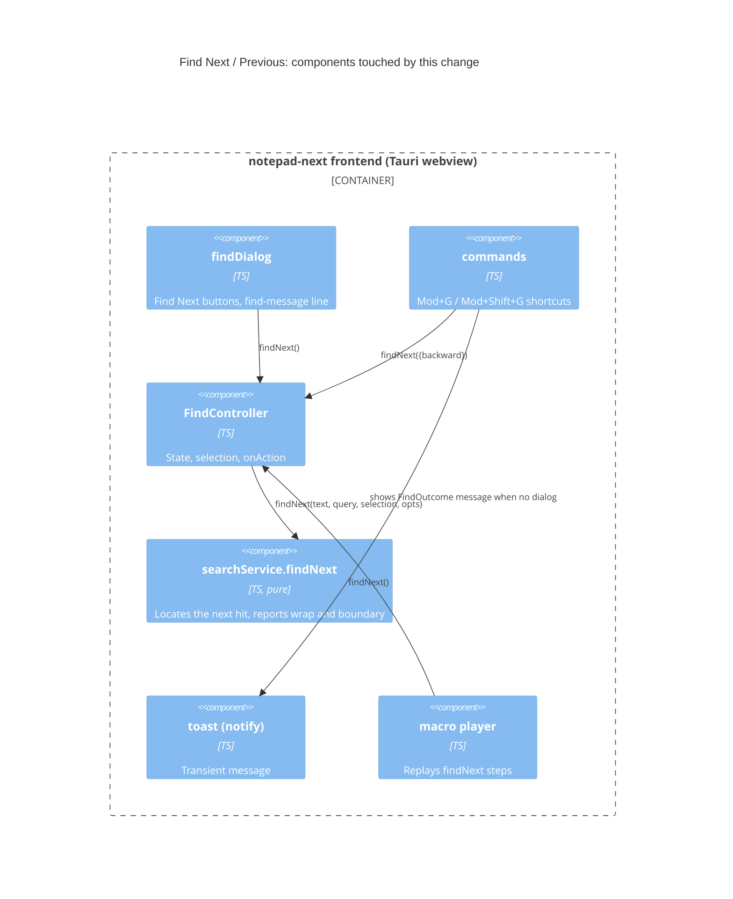

## Context

Find Next and Find Previous are implemented in three layers:

- `search/searchService.ts` `findNext(text, q, sel, opts)` is a pure function. It returns the next `Range`, or `null`. With `wrap` off and no match past the caret it returns `null`. With `wrap` on it falls back to the first hit (or the last hit when searching backward).
- `search/findController.ts` `FindController.findNext()` selects the hit and returns a `boolean`. `FindState.wrap` defaults to `false` (`DEFAULT_FIND_STATE`) and is held in memory only. It is not persisted.
- Two callers show the result:
  - `search/findDialog.ts`: the Find Next buttons show "Can't find the text" in the `find-message` status line when the result is `false`.
  - `app/commands.ts`: `search.findNext` and `search.findPrev` (Mod+G, Mod+Shift+G) discard the result, so nothing is shown. This is the "nothing happens" the user sees.

`FindController.replace()` also calls `findNextCore()` after a replacement (`findController.ts:125`). `macro/player.ts:125` calls `finder.findNext()` and treats `false` as a failed step.

Constraints:

- The in-force ADRs (0001-0010) set no constraint on search messaging. ADR-0006 (macros store high-level steps) matters only in that macro playback must keep working.
- A toast already exists (`app/toast.ts`, wired in `main.ts` as `notify`).

C4 component view of the affected area (Mermaid C4; the `c4-diagrams` skill the rules ask for is not installed in this environment, so the diagram is written by hand):

## Goals / Non-Goals

**Goals:**
- Every Find Next/Previous that reaches the document boundary, or has no matches, tells the user so.
- "Wrap around" defaults to on.
- The same message logic serves the dialog and the shortcuts, so they cannot drift apart.

**Non-Goals:**
- Mark, Find in Files and Replace in Files.
- Persisting the wrap setting across sessions. It is in-memory today and stays that way.
- Changing how matches are found or ordered.
- Auditing audible or visual wrap cues beyond the message text.

## Decisions

**1. Return a richer result, not a boolean.**
`searchService.findNext` returns `{ range, wrapped } | { range: null, reason: "none" | "boundary" }`. `FindController.findNext()` returns a `FindOutcome` (`"found" | "wrapped" | "boundary" | "none"`) and still selects the hit.
- Why: the service already knows which case it hit, and recomputing it in the callers would duplicate the caret and match logic.
- Alternative: leave the boolean and compare the new caret to the old one to guess a wrap. This is fragile, for example with a single match or zero-length matches. Rejected.
- Alternative: call `collect` twice (with and without wrap). Rejected: it costs two scans and splits the logic.

**2. One message formatter, `findMessage(outcome, backward)`, in `search/`.**
It returns the text for each outcome:
- `wrapped`: "Reached end of document, continuing from top", or "Reached start of document, continuing from bottom" when searching backward.
- `boundary`: "No more results".
- `none`: "No results found".
- `found`: no message.

- Why: the dialog and the shortcuts share one source of wording, and tests cover it in one place.
- Alternative: format strings inline in each caller. Rejected: this is how "Can't find the text" and the silent shortcut diverged.

**3. Surface by context.**
- Dialog open: the existing `find-message` line. It already stays until the next action, which gives the "no timers" lifetime.
- Dialog closed (shortcuts): the toast, through the same `notify` that `main.ts` creates. `info` kind for `wrapped`, `info` for `boundary` and `none`.
- How `commands.ts` learns the dialog is open is an implementation detail for tasks. The simplest answer is that the shortcut always toasts, since a toast alongside the open dialog's own message is harmless. The task step confirms this against the UI.

**4. Flip the default in `DEFAULT_FIND_STATE`.**
Change `wrap: false` to `wrap: true`. Wrap is not persisted, so there is no migration, and existing sessions pick the new default on next launch.

**5. Macro playback.**
`player.ts` keeps treating "no hit" as a failed step. A `wrapped` outcome counts as success. A `boundary` or `none` outcome stays a failure. The player uses `outcome !== "boundary" && outcome !== "none"` and does not show messages.
- Why: replaying a recorded Find Next must not start failing or toasting.

**6. Replace.**
`replace()` calls `findNextCore()` after replacing. It adopts the same outcome, so the dialog shows "Reached end of document, continuing from top" after the last replacement on a wrap, rather than staying silent.

## Risks / Trade-offs

- [Wrap default on changes behaviour for existing users, who may expect Find Next to stop at the end] -> It is an unchecked box away, and the message tells them exactly what happened. Called out in the proposal.
- [Toast duration (4 s) may hide a message from a user who looks away] -> Acceptable for a transient hint. The dialog line persists when the dialog is used.
- [`findNext`'s return type changes, which breaks the existing unit tests and any other callers] -> The only callers are `findController.ts`, the dialog, `commands.ts` and `macro/player.ts`. Update the tests in the same change.
- [Messages repeat on every key press when holding Mod+G on a one-match document] -> The toast replaces the previous text, so it does not stack.

## Migration Plan

No data migration, because wrap is not persisted. Ship in one change. Rollback is reverting the commit.

## Open Questions

- Should the message also be announced for screen readers beyond `role="status"`? Both the dialog line and the toast already use `role="status"`, so likely no.
- No in-force ADR needs superseding. A new ADR for the find-outcome contract may be warranted, and the adr step decides that.
